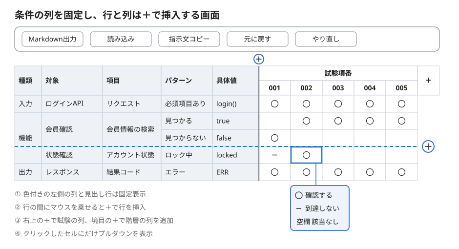

# 試験マトリクス作成支援ツール

ソフトウェアテストの試験マトリクスを、ブラウザで作るためのツールです。
条件（行）と試験項番（列）を手軽に追加・編集し、外部のAIとMarkdownでやり取りして印を付けます。



- HTMLファイル1つだけで動きます。インストールやインターネット接続は不要です
- 動作環境：Microsoft Edge（Chrome でも動きます）

## 入手方法

[`dist/test-matrix-editor.html`](dist/test-matrix-editor.html) をダウンロードし、ダブルクリックしてEdgeで開いてください。

## 使い方

1. **名前を付ける**：ツールバーの左端の欄に、マトリクスの名前を入力します（例：ログインAPI試験）
2. **条件を入力する**：表の左側（種類・対象・項目・パターン・具体値）に、試験の条件を入力します
3. **指示文をコピーする**：ツールバーの「指示文コピー」を押すと、AIへの指示文と条件の表がまとめてコピーされます
4. **AIに渡す**：コピーした内容をAIに貼り付けて送ります。設計書などの参考資料があれば、一緒に渡してください
5. **AIの返答を読み込む**：「読み込み」を押し、AIの返答を説明文ごと貼り付けて「読み込む」を押します
6. **確認する**：色の付いたセルを確認し、必要に応じて直します
7. **保存する**：「保存」を押し、保存先のフォルダとファイル名を選びます。保存したHTMLを開けば、続きから確認・編集できます

### 表の操作

| やりたいこと | 操作 |
| --- | --- |
| セル・見出しを編集する | クリックして入力し、Enter で確定（Esc で取り消し） |
| 印を付ける | 試験の列のセルをクリックし、○ / − / 空欄 から選ぶ |
| 行を挿入する | 行の間にマウスを乗せ、破線の右端の＋を押す。上の行の値を引き継ぎます |
| 試験の列を挿入する | 試験の列の間にマウスを乗せ、破線の上の＋を押す。右端の＋で末尾に追加 |
| 階層の列を追加する | 左側の見出しにマウスを乗せると、一番右の階層の見出し（初期状態では「パターン」）の右端に＋が出るので押す |
| 複製・削除する | 行・列を右クリックしてメニューから選ぶ |
| 元に戻す・やり直す | Ctrl+Z / Ctrl+Y（ツールバーのボタンでも可） |
| 表をすべて消す | ツールバーの「すべてクリア」を押し、確認で「クリアする」を選ぶ。Ctrl+Z で取り消せます |

左側の条件の列と見出しの行は、スクロールしても固定されたままです。

### 印の意味

| 印 | 意味 |
| --- | --- |
| ○ | 確認する観点 |
| − | 手前の条件で処理が止まり、到達しない |
| 空欄 | 該当しない |

### 色の意味

| 色 | 意味 |
| --- | --- |
| オレンジ | 読み込み時の警告。○・−・空欄以外の文字や、AIが書き換えた条件など |
| 赤 | 網羅チェック。○ が1つも無い条件の行（具体値の列）と、○ が1つも無い試験の列（項番）。出力の行と、条件が空の行は対象外です |

色の付いたセルにマウスを乗せると、理由が表示されます。網羅チェックの件数は、画面下のステータスバーに表示されます。

## 保存

### ファイルへの保存（名前を付けて保存）

- 「保存」「名前を付けて保存」を押すと、**ツールとマトリクスのデータを1つにまとめたHTMLファイル**を保存します。保存の画面で、保存先のフォルダとファイル名（初期値は「名前.html」）を選びます
- 保存したHTMLをダブルクリックすると、保存したときの内容が表示され、そのまま続きを編集できます。ほかのPCにコピーしたり、ほかのメンバーに渡したりしても開けます
- 「保存」は、一度保存した後は同じファイルに上書きします。ただし、HTMLを開き直した後の最初の保存では、ブラウザの制約で保存先を選ぶ画面が出ます。同じファイルを選んで上書きしてください
- 「名前を付けて保存」は、別のファイルとして保存します（コピーを作るときに使います）
- 最後に保存した後に変更があると、ブラウザのタブの名前の先頭に「*」が付きます
- 保存の画面が使えない環境では、ダウンロードフォルダに保存されます

### ブラウザ内への自動保存

- 編集した内容は、ブラウザ内にも自動で保存されます。保存したHTMLは、ファイルごとに別々に自動保存されます
- ファイルに保存した後、保存せずに閉じてしまっても、次にそのHTMLを開いたときに「続きから開く」を選べば、編集を取り戻せます
- ただし、**ブラウザのキャッシュや閲覧データを消すと、自動保存の内容は消えます**。大事な作業は「保存」でファイルに残してください
- 保存していない元のツール（`test-matrix-editor.html`）の自動保存は、同じPCで1つだけです。一度ファイルに保存すると、元のツールは次に開いたときに新規の状態から始まります

### ツールを新しい版にするとき

保存したHTMLには、保存した時点の版のツールが入っています。新しい版のツールで続きを編集したいときは、新しい版の `test-matrix-editor.html` を開き、「読み込み」で保存したHTMLを選んでから、「名前を付けて保存」で保存し直してください。

## AIとのやり取りの書式

- Markdownの書式：[docs/markdown-format.md](docs/markdown-format.md)
- AIへの指示文：[docs/ai-prompt.md](docs/ai-prompt.md)

読み込めない表（エラー）や、確認が必要な点（警告）の一覧は、書式の6章にあります。

## 開発

Node.js（v22以上）が必要です。外部のnpmパッケージは使いません。

```bash
npm test
```

```bash
npm run build
```

- `src/` のファイルを1つにまとめて、`dist/test-matrix-editor.html` を作ります
- AIへの指示文は、ビルドのたびに `docs/ai-prompt.md` から取り出して埋め込みます
- 要件・設計は [docs/](docs/) にあります（[要件定義書](docs/requirements.md)・[実装計画](docs/implementation-plan.md)）
